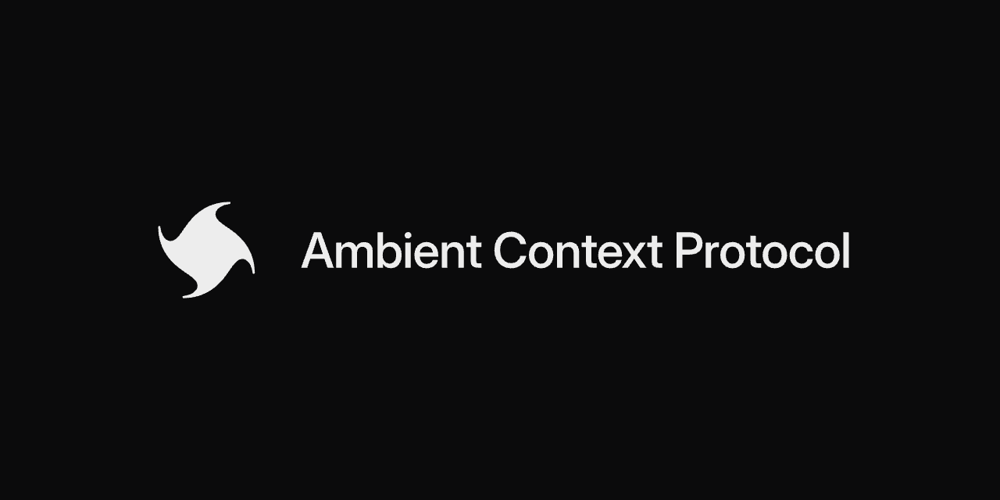

# Ambient Context Protocol

> A way for a desktop app to tell an agent what you have open, what you have selected, and where it is on screen.

**Draft 0.2.2.** The specification is written to 0.2.2; the packages and the first apps are moving to it and still exchange 0.1. Every name below may change.

## What it is

An agent that lives beside your apps cannot see into them. The app already knows what you have open and what you have selected. This protocol lets it say so, in one form that every app and every agent can share.

There are two roles. A **provider** is an app that answers questions about itself: an editor, a task tracker, a design tool. A **host** is the agent's own app. It asks providers for context when the user acts, shows the user what it collected, and passes it to the agent.

A provider answers two questions.

**What is open and in focus?** The provider returns one tree of elements, rooted at the app. Each element says how it is shown (`role`), what it is in the app's own word (`subrole`), and whether it is selected, focused, visible or under the pointer.

```json
{
  "protocol": "0.2.2",
  "instance": "k3f9x2",
  "root": {
    "id": "app", "role": "Application", "title": "Editor",
    "children": [
      { "id": "win-1", "role": "Window", "focused": true, "children": [
        { "id": "doc-1", "role": "Document", "subrole": "markdown", "title": "draft.md",
          "url": "file:///Users/ada/essays/draft.md", "focused": true, "children": [
            { "id": "sel-23", "role": "Text", "selected": true,
              "content": [
                { "type": "text", "text": "The command line lasted thirty years as the main way people used computers." }
              ] }
        ] }
      ] }
    ]
  }
}
```

**Where is this element?** Given an id, the provider returns where the element is on screen, so the host can put its own interface beside it.

```json
{
  "id": "sel-23",
  "state": "visible",
  "rects": [{ "x": 425, "y": 233, "w": 480, "h": 20 }],
  "window": 48211,
  "edge": "right"
}
```

The id is short and opaque. It keeps pointing at the same passage after the user types above it, so an agent can refer to `sel-23` minutes later and the host can still find it.

It is an extension to the Model Context Protocol. A provider is a small MCP server on the local machine, and the two answers are MCP resources: `ambient://current` and `ambient://location/{id}`. The host reads them; the agent never calls the app. Any MCP client can list and read them, including one that has never heard of this protocol.

A running provider announces itself with a descriptor file that only the user can read. The file gives the endpoint and a token minted at launch. A host finds the frontmost app's descriptor, connects, and asks.

## Principles

1. *The app says where; the host decides what.* A provider reports elements and their positions. It never names what the host draws there.
2. *A shared language for how a thing is shown, the app's own word for what it is.* Thirteen roles every app shares; the subrole and attributes are the app's to define.
3. *Pulled on the user's action, and kept current while the user is looking.* A host asks for context when the user does something that calls for it, and may ask to be told when it changes while it is showing the user what it read. A provider sends nothing a host did not ask for, and a host does not poll.
4. *It is ordinary MCP.* A provider is an MCP server and the two answers are MCP resources.

## Status

| | |
|---|---|
| Specification | [Draft 0.2.2](docs/spec/index.md) |
| First provider | [Paper](https://github.com/humanitas-labs/paper), a Markdown editor for macOS. Planned. |
| First host | Sirius. Planned. |
| Platforms | macOS first |

## In this repository

- [`docs/pm.md`](docs/pm.md): the product model. Domains, Features, Requirements and how each is verified.
- [`docs/spec/`](docs/spec/index.md): the protocol, draft 0.2.2. Operations, elements, locations, the MCP binding and discovery.
- [`schema/`](schema/current-0.2.2.json): a JSON Schema for the answer to "what is open", and `tools/` with the checks that go with it.
- [`docs/rfcs/`](docs/rfcs/README.md): how the protocol changes, and the accepted proposals behind 0.2.2.
- [`sdk/swift`](sdk/swift/README.md): a Swift package that makes a macOS app a provider. The app says what is open and selected; the package does the rest.
